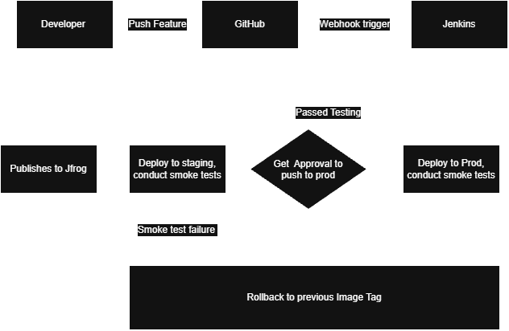
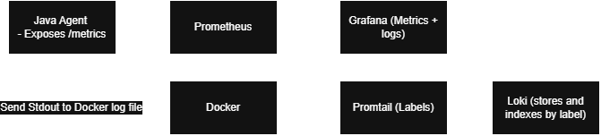

# System Health Dashboard API

A Spring Boot API that reports service health, version and environment of the java API as well as 2 python agents that communicate with Kafka to which the java API is reading and can be called upon from the user.
built with a Git, Docker and Jenkins, jfrog delivery workflow.

### Architect
### Delivery Pipeline


### Data flow



**Delivery flow:** 
- A merged change triggers Jenkins, which tests, builds and tags the images and publishes
them to JFrog.
- Jenkins deploys that image to **staging** automatically over SSH, runs a smoke test and checks
Prometheus can see it.
- On `main`, it then waits for a **human approval** before deploying the **same image**
to **production**. 
- If a smoke test fails after a deployment, it rolls back to the previous image tag.


## Prerequisites
- JDK 21, Python 3.11+, Docker Desktop
- Jenkins running in Docker with the Docker CLI and Compose plugin (`jenkins-with-docker` image)
- A JFrog account with a `docker-local` repository
- An AWS EC2 host (Ubuntu 24.04, 8 GB) with Docker, the repo cloned, and ports 22, 3000–3002, 5001–5002
  and 9090 open to your IP only

## Setup
```
git clone https://github.com/MMuiry/SRE-system-health-dashboard.git
cd SRE-system-health-dashboard
```

## Config 
ENVIRONMENT - default: unknown (name of the environment, shown at /environment and in logs and metrics)
APP_VERSION - default: 1.0.0, Jenkins sets this to the image tag
PORT - default: 8081, containers use 8080
ENABLE_FAULT_INJECTION - default: false, turns on /simulate-error for incident drills (staging only)
KAFKA_ENABLED - default: false, compose overrides this with true
KAFKA_BOOTSTRAP_SERVERS - default: localhost:9092, containers use kafka:19092
MACHINE_NAME - default: computer/container's own name
PUBLISH_INTERVAL_SECONDS - default: 5, how often the Python agents publish stats


## Endpoints
Java API -
/health, /version, /environment - status, version and environment
/events - last 20 health events from Kafka
/machines - latest stats for each machine from Kafka
/metrics - Prometheus metrics
/simulate-error - returns 500 and logs an ERROR when fault injection is on, otherwise 404

Python agent -
/health, /system - status and machine stats


## Metrics
http_requests_total - counter, labels: method, endpoint, status
http_request_duration_seconds - histogram, label: endpoint
app_info - always 1, labels: version, environment
app_uptime_seconds - my custom metric, seconds since the app started. If it drops back to 0 the app has restarted (deploy, rollback or crash)

## Logging
Every request writes one JSON line to stdout with timestamp, level, message, endpoint, method, status and environment.
5xx responses are logged as ERROR, 4xx as WARN, everything else as INFO.

## Kafka (AI assisted to create)
topic channels
system-health-event: every time /health for java API is called, it will be published to Kafka and can be called from the Java API with /events showing the last 20 events

system-metrics: Python agents publish stats every 5seconds, can be called using machines() on the java API


## Running tests
Java API tests -
./mvnw test          # Git Bash / Linux / Mac
.\mvnw.cmd test      # Windows PowerShell

Python agent tests -
cd agent; .venv\Scripts\python -m pytest    # Python

## Run
cd to the SRE-system-health-dashboard directory
docker compose up -d --build
http://localhost:3000/

Java api as it port 8082 (8080 on container)
Python api is at port 5001, 5002 (5000 container)
Dashboard is at 8088 (80 on the container)


## Staging and production
Each environment runs the same image pulled from JFrog using the same image from staging to production
Staging - docker-compose.staging.yml, Java API on port 5001, dashboard on port 3001
Production - docker-compose.production.yml, Java API on port 5002, dashboard on port 3002, fault injection always off

Deploy by hand on the server -
./scripts/deploy.sh staging <image-tag>
./scripts/smoke_test.sh 5001 <image-tag>


## Monitoring stack
On the server, from the project directory -
docker network create sre-net
cp monitoring/.env.example monitoring/.env    (then set GRAFANA_ADMIN_PASSWORD)
docker compose -f monitoring/docker-compose.monitoring.yml up -d

Grafana is at port 3000 - login admin, password from monitoring/.env (see monitoring/.env.example)
Prometheus is at port 9090
Loki is at port 3100

## Continuous Delivery or Continuous Deployment
This pipeline is Continuous Delivery. Every change merged into develop or main is tested, published to JFrog and deployed
to staging automatically. This is where the automation stops as it requires human approval on Jenkins 
for it to start deploying to prod and perform smoke testing. This can be changed by removing the permission
request in jenkins in the stage 'approval'


## Dashboard (AI created)
Displays both python agents as well as the Java API health.
reach it at http://localhost:3000/


