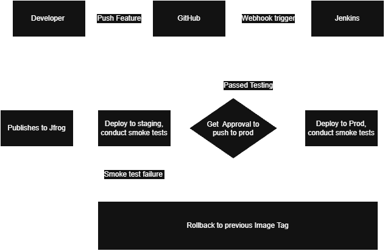
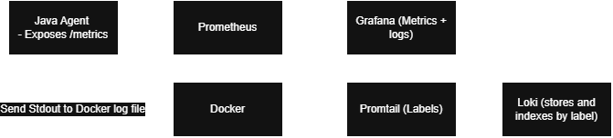

# System Health Dashboard API

A Spring Boot API that reports service health, version and environment of the java API as well as 2 python agents that communicate with Kafka to which the java API is reading and can be called upon from the user.
built with a Git, Docker and Jenkins, jfrog delivery workflow.

## Prerequisites
JDK 21, Python 3.11+, Docker Desktop

## Setup
git clone https://github.com/MMuiry/SRE-system-health-dashboard.git

## Config 
APP_ENV - default: Unknown
APP_VERSION - default: 1.0.0
PORT - default: 8081, compose overrides this to 8082
KAFKA_ENABLED - default: False - compose overrides this with True
KAFKA_BOOTSTRAP_SERVERS - default: kafka:19092
MACHINE_NAME - default: computer/containers own name

## Running tests
Java API tests -
./mvnw test          # Git Bash / Linux / Mac
.\mvnw.cmd test      # Windows PowerShell

Python agent tests -
cd agent; .venv\Scripts\python -m pytest    # Python

## Run
cd to the SRE-system-health-dashboard directory
docker compose up -d --build
http://localhost:3000/

Java api as it port 8082 (8080 on container)
Python api is at port 5001, 5002 (5000 container)
Dashboard is at 3000 (80 on the container)

## Kafka (AI assisted to create) 
topic channels
system-health-event: every time /health for java API is called, it will be published to Kafka and can be called from the Java API with /events showing the last 20 events

system-metrics: Python agents publish stats every 5seconds, can be called using machines() on the java API

## Git Workflow
local Feature branch PR into origin develop branch, Jenkins checks every 1 min for changes and performs CI. If succeed, push to jfrog.

##Dashboard (AI created)
Displays both python agents as well as the Java API health.
reach it at http://localhost:3000/

##Project Extention (Adding CD Pipeline)
Architect - 
CD pipeline

Data flow

